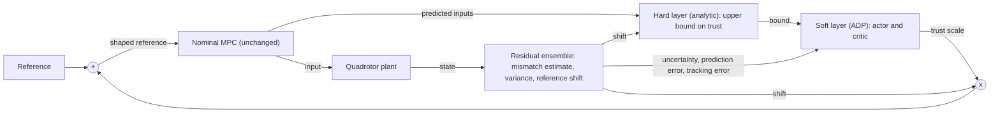

# How Much to Trust a Learned Model

**Safe Adaptive Dynamic Programming for Supervising Residual-Augmented Quadrotor MPC**

> **Status:** Phase 1 of 8 complete: first-principles dynamics (notebook 00 to 04), audited and corrected ([`notebook/99_audit.md`](notebook/99_audit.md)), with design decisions logged in [`notebook/decisions.md`](notebook/decisions.md). The theory entries 05 to 15 are being written next. No controller, network, or supervisor code exists yet. See [Roadmap](#8-roadmap-and-status).

A learned residual model can make a quadrotor model predictive controller (MPC) better, leave it unchanged, or make it worse. This project asks **how much of a learned correction the controller should use at each moment**, and whether that decision can itself be learned with a guarantee that it does not degrade the nominal design.

The answer proposed here is a two-layer supervisor. An analytic **hard layer** computes an upper bound on trust from three closed-form quantities: actuator realizability, loop gain, and a barrier condition. Inside that bound, a learned **soft layer**, trained by adaptive dynamic programming (ADP), chooses the trust level. The nominal MPC is never modified, and zero trust reproduces it exactly.

The full derivations are in the [`notebook/`](notebook/), which is the technical source of truth for this project. This README is the summary.

---

## 1. Motivation

MPC is the standard tool for quadrotor trajectory tracking because it plans over a horizon while respecting actuator limits [1]. Its accuracy depends on its internal model, and mass change, rotor drag, motor lag, and actuation delay all cause mismatch. Learned residual models are the common remedy [5], [6], [7].

Our earlier study, presented at IEEE iCONEECT 2026 [19] ([code](https://github.com/Ashfak-Kausik/uav-mpc-learning)), injected a learned residual as a feedforward term into a quadrotor MPC in MuJoCo. The same accurate residual:

- **helped** under some mismatches,
- **did nothing** under others,
- **degraded tracking** under motor lag and delay near the stability boundary.

That study established the pattern but did not explain it. This repository is a clean-room rebuild that aims to explain it and to build a controller around the explanation. The earlier repository is treated as a frozen artifact: it is reproduced later as a check and never copied.

---

## 2. Research questions

| # | Question | Hypothesis |
|---|----------|------------|
| RQ1 | Which mechanism causes the harm, and does it survive a safer injection point? | Two mechanisms can degrade tracking at the reference level: **saturation** (the shifted reference demands more input than the rotors can deliver) and **loop gain** (the correction depends on the state, so it closes an extra feedback path around a loop whose margin lag and delay have already reduced). Mass is corrected at any trust level, drag changes little, and the harm under lag and delay comes mainly from loop gain, before any actuator saturates. Tested with an oracle correction before any network is trained. |
| RQ2 | Do the analytic bounds predict help and harm better than model uncertainty does? | The realizability ratio and the small-gain bound separate helpful from harmful corrections better than ensemble variance, measured as classification AUC. Labels come from paired rollouts with trust at 0 and at 1. |
| RQ3 | Can ADP learn the trust policy? | A learned soft layer achieves lower tracking cost than the nominal controller, the best fixed trust level, and an uncertainty-only gate, with one policy across all mismatch types, including unseen magnitudes and combinations. |
| RQ4 | What can be guaranteed? | Full transmission of the correction below the realizability ratio, stability and constraint satisfaction for any soft policy, and statistical non-degradation of the learned supervisor. |

If the degradation in RQ1 vanishes entirely, the role of the supervisor shifts from safety to performance. The method is unchanged in either case.

---

## 3. Method at a glance



**Mismatch model.** Motor lag and delay are dynamic, so the plant is modeled on an augmented state that includes the actuator states. On the Crazyflie the motor is slower than the attitude dynamics, so the identified motor lag is part of the nominal model. The lag mismatch is therefore an error in its time constant, while actuation delay remains a pure mismatch. The mismatch is the one-step prediction error of the nominal model, and a deep ensemble [15] predicts it from a short window of recent inputs.

**Reference shaping.** The MPC tracks a planned trajectory over its horizon, with feedforward computed from the plan's own derivatives ([notebook 08](notebook/08_reference_correction.md)). The predicted mismatch is mapped to a saturated shift of the reference's position and yaw over the horizon. The shift is never differentiated. It does not shorten the plant's chain of integrators. What it changes is that the rotor commands are computed by the constraint-aware MPC, and that the correction reaches the output through the closed loop.

The correct correction is defined as an *oracle*: the regularised least-squares reference shift that best restores tracking under the true mismatch.
- **Mass and drag:** it equals a steady offset.
- **Motor-lag error and delay:** it is zero on set-points and nonzero only along moving references.
- **What can change stability:** a correction that depends only on the plan is feedforward and cannot move a stability limit. A learned correction that depends on the measured state is feedback and can move it, above all through its sensitivity to tilt.

```math
\tilde{r}_k = r_k + \alpha_k \, \Delta r_k, \qquad \alpha_k \in [0, \bar{\alpha}_k]
```

Here $\alpha_k$ is the trust scale and $\bar{\alpha}_k$ is its upper bound. With $\alpha_k = 0$ the system is exactly the nominal baseline.

**Hard layer (analytic, no second optimization).** Three closed-form bounds are combined, one per failure mechanism:

```math
\bar{\alpha}_k = \min\left( r_H, \; \alpha_{\mathrm{sg},k}, \; \alpha_{\mathrm{cbf},k} \right)
```

| Bound | Guards against | How it is computed |
|-------|----------------|--------------------|
| $r_H$, realizability ratio | Actuator saturation | The largest fraction of the requested correction that the rotors can absorb over the horizon under thrust and rate limits. A ratio test on the inputs the MPC already predicts, $O(Nm)$ divisions, no solver |
| $\alpha_{\mathrm{sg},k}$, small-gain bound | Loop gain of the correction path | From the small-gain theorem [36], [37]: trust times the certified Lipschitz constant of the correction map [48], [49] times the closed-loop gain must stay below one. The closed-loop gain is computed offline over the mismatch set |
| $\alpha_{\mathrm{cbf},k}$, barrier bound | State limits (tilt, altitude) | Discrete-time control barrier condition [44] with a robustness margin, using high-order constructions [45], [11], [12], because tilt and lateral position have relative degree above one |

Only quantities that can be bounded analytically enter the hard layer. Ensemble uncertainty is an estimate, so it is passed to the soft layer as information.

**Soft layer (learned).** The trust decision is posed as an optimal control problem with a seven-dimensional state and one action:

```math
s_k = \left( r_H, \; \alpha_{\mathrm{sg},k}, \; \psi_k, \; \iota_k, \; \|e_k\|, \; \|e_k\| - \|e_{k-1}\|, \; \alpha_{k-1} \right)
```

```math
\alpha_k = \Pi_{[0, \bar{\alpha}_k]}\left( \alpha_{k-1} + a_k \right), \qquad
J(\pi) = \mathbb{E}_{\theta}\left[ \sum_{k \ge 0} \gamma^k \left( e_k^{\top} Q \, e_k + \lambda a_k^2 \right) \right]
```

Here $\psi_k$ is a clipped measure of ensemble variance, $\iota_k$ is the ensemble's measured prediction error at the previous step, and $e_k$ is the tracking error. The action is a bounded increment of trust. The hard layer can cut trust immediately, while increases are rate limited. The policy is trained with action-dependent heuristic dynamic programming [13] on simulated rollouts across mismatch types and magnitudes.

**Safe policy improvement.** The policy that keeps trust at zero reproduces the nominal MPC exactly, so learning starts from it, as policy iteration starts from an admissible policy [14]. That starting point does **not** by itself guarantee anything: the trust state is a partial observation of the closed loop, so the monotone improvement of exact policy iteration cannot be assumed. Non-degradation comes only from a statistical acceptance test [34], [39]. Every actor and critic update is treated as a candidate. A candidate replaces the current policy only if paired rollouts, separate from the data used to propose it, show a statistically significant improvement on average and no loss beyond a tolerance on any single mismatch type.

---

## 4. Theoretical targets

**Assumptions.**
1. The nominal controller is an MPC-for-tracking design [16], [38]. It has hard constraints only on its input (per-rotor thrust box and rate limit), soft state constraints, and no terminal set (a terminal cost on the artificial steady state is allowed).
2. For every mismatch in the set under study, the nominal closed loop satisfies its constraints and is input-to-state stable with a finite gain. This is **verified numerically** for every mismatch in the set, not assumed.
3. The reference shift is bounded and Lipschitz.

Assumption 2 sets the scope: no claim is made beyond the stability boundary of the nominal loop.

**Target Result 1: transmission of the correction.** For the linearized MPC, if no constraint is active and trust is at or below the realizability ratio, no input constraint becomes active and the MPC acts as its unconstrained affine law [35]. The correction is transmitted in full.

**Target Result 2: safety for any soft policy.** For any trust level inside the hard bound:
- (i) the MPC is feasible. This is trivial, because only input constraints are hard and holding the previous command is always admissible.
- (ii) The closed loop is input-to-state stable. This follows from Assumption 2 plus the small-gain bound, stated in gain form so that it holds however the trust level is chosen.
- (iii) The state limits are kept within the barrier margin, which follows from the barrier bound.

This holds regardless of what the learning component does. Results 1 and 2 are the subject of the conference paper; Result 3 belongs to the journal version.

**Target Result 3: non-degradation of the learned supervisor.** With high probability, every policy accepted by the improvement test has expected cost no higher than the nominal controller, and no higher than nominal plus a tolerance on each mismatch type. The guarantee is statistical: it holds in expectation over the training distribution and inside the simulator.

These are targets, not established results.

---

## 5. Evaluation plan

**Setup.**
- **Vehicle.** Crazyflie 2.1+ with standard propellers. Thrust and torque constants come from the Bitcraze firmware (thrust-to-weight ratio about 1.69). Inertia and motor lag come from Förster's system identification [51]. The source of every parameter is listed in [notebook 01](notebook/01_forces_and_torques.md). Maximum thrust and the thrust map will be re-identified on a bench once the hardware arrives.
- **Simulation.** MuJoCo [43], starting from the Menagerie model [53], with rotor-level actuation (per-rotor limits, mixer, motor lag, delay) implemented in our own interface, because the Menagerie model is actuated by a body wrench.
- **Controller.** A linear MPC for tracking on the lagged hover model, solved with the dual active-set QP solver DAQP [58]. Its target is the Crazyflie's own microcontroller at 100 Hz, following on-board MPC precedent on the same vehicle [54], [55], [56]; on-board feasibility for our problem size is an estimate until measured. Running on board keeps radio latency out of the loop, where it would otherwise be an unmeasured delay. A nonlinear MPC (CasADi [41], IPOPT [42], acados [40]) is at most a simulation-only comparison. The closest prior work puts a learned residual *inside* an embedded MPC [57]; ours only shifts the reference of an unchanged one.
- **Trajectories.** Hover, circle, figure-eight, and an aggressive figure-eight close to the actuator limits.
- **Generalization.** A second, heavier vehicle tests cross-vehicle generalization. RotorPy [52] provides a sim-to-sim check, with its rotor order mapped to ours and its yaw-moment coefficient set to our value, plus one run with its native value.

**Mismatches.** Mass, rotor drag, an error in the motor time constant, and actuation delay, individually and in combination, with severities normalized to the vehicle's own limits and to the nominal loop's stability boundaries ([notebook 07](notebook/07_perturbation_models.md)).
- **Admissible set.** It is verified numerically. The nominal loop is stable for every mass and drag level studied, for motor-lag errors from 0.3 to 2 times the modelled time constant, and for injected delays up to two control periods.
- **Interaction.** A lag error narrows the delay margin: a motor 50 % faster than modelled cuts it from 24.6 ms to 15.8 ms.
- **Stress tests.** The points outside the admissible set.

**Baselines.**

| # | Baseline | Question it answers |
|---|----------|---------------------|
| 1 | Nominal MPC (trust fixed at 0) | What must not be underperformed? |
| 2 | Unsupervised residual (trust fixed at 1) | What does the correction do with no supervision? |
| 3 | Best fixed trust level | Is a time-varying trust level needed? |
| 4 | Hard layer with a threshold rule, no learning | What does the ADP soft layer add? |
| 5 | Uncertainty-only gate [31] | Is realizability needed, or does uncertainty suffice? |
| 6 | Soft layer trained without the acceptance test | What does the safe improvement step add? |
| 7 | Residual inside the MPC model [5] | How much performance does reference-level injection give up? |
| 8 | Offset-free MPC [23] | Is a learned model needed for constant mismatch? |
| 9 | L1-adaptive MPC [24] | Is a learned model needed at all? |
| 10 | Predictive safety filter [9] | How does a closed-form bound compare with an online optimization? |
| 11 | Reference governor [17] | How does it compare with classical reference scaling? |
| 12 | Safe learning control with high-order barrier functions [12] | How does supervising the trust compare with learning the controller under a barrier? |

All baselines get an equal tuning budget.

**Metrics.** RMS and peak tracking error, fraction of time in actuator saturation, number of constraint violations, per-step supervisor computation time on a CPU, and AUC of the analytic bounds versus ensemble variance for classifying helpful and harmful corrections. Results are reported over at least ten seeds with confidence intervals. The tracking error at zero injected mismatch, caused by discretization and the deliberate model simplifications alone, is measured first as a noise floor, and no effect below it is claimed.

**Generalization and ablations.** Unseen mismatch magnitudes and combinations, and one mismatch type held out in rotation. Ablations remove each hard bound and each trust-state component in turn.

**Stress tests.** (1) Mismatch introduced during flight. (2) A deliberately corrupted residual network. (3) Mismatch increased past the stability boundary of the nominal loop, to locate where the claims stop.

---

## 6. Predictions recorded before any experiment

Notebook entry 04 classifies the four mismatches from an equilibrium analysis alone. The effect of a correction also depends on whether the nominal MPC already rejects constant disturbances. The primary nominal MPC has **no** disturbance model; offset-free MPC is a separate baseline. So each prediction is given for both cases.

| Mismatch | Moves the hover equilibrium? | Channel | Effect of the residual, nominal MPC **without** disturbance model (primary) | With disturbance model (offset-free baseline) |
|----------|------------------------------|---------|---------------------------------------------|---|
| Mass | Yes, a constant bias | Vertical (two integrators) | Removes a constant altitude offset: helps | Largely redundant: little change |
| Drag | No, but breaks constant-velocity trim | Lateral, state dependent | Reduces a small velocity-dependent lag: helps a little, more at speed | Little change |
| Motor-lag error | No, it removes phase margin | Lateral, at the entrance of a four-integrator chain | Hurts past a threshold; may weaken or vanish, since the identified lag is in the nominal model and the correction passes through the MPC | Threshold moves with the observer dynamics |
| Delay | No, it removes phase margin faster | Lateral, at the entrance of a four-integrator chain | Hurts, with an earlier threshold | As lag error |

With the nominal controller fixed (notebook 06), these predictions were re-registered quantitatively ([decisions.md](notebook/decisions.md)). The numbers below are for the implementation the hardware will run, in which the one-period computation delay is modelled by the MPC:
- **Delay:** the nominal loop loses stability at 24.6 ms of injected delay (2.5 control periods), beyond the modelled computation delay. On hardware this budget is shared with the still unmeasured state-estimation latency.
- **Motor-lag error:** the nominal loop loses stability only when the true motor time constant exceeds 2.9 times the modelled one (or falls below 0.19 times it). Within a ±50 % lag error it stays stable. Lag error is therefore the benign control case, and any harm from it would have to come from the correction path itself. Delay is the primary destabilizing case.
- **Mass:** +10 % mass leaves a 53 mm altitude offset.
- **Drag:** on a 1 m/s ramp, drag adds only 24 mm to a 0.48 m lag that is intrinsic to set-point tracking.

If the experiments contradict these, the predictions change and the reason is investigated.

---

## 7. Related work

| Line of work | Representative papers | What it leaves open |
|--------------|-----------------------|---------------------|
| Learned residuals in MPC | Aswani et al. [2], Torrente et al. [5], Salzmann et al. [6], O'Connell et al. [22] | The learned term is applied whenever it is available |
| Mismatch handling without a learned model | Pannocchia and Rawlings [23], Hanover et al. [24] | No learned correction to supervise |
| Safety layers and run-time assurance | Hewing et al. [8], Wabersich and Zeilinger [9], Garone et al. [17], Liu et al. [25], Sinha et al. [26] | Decide whether an action is safe, not how much of a correction is worth using |
| Gating and blending a learned correction | Cheng et al. [28], Cramer et al. [29], Jeon et al. [30], Colombo et al. [31], Iscan and Temiz [32] | The scale is fixed, a hand-designed function of uncertainty, or a discrete action with no baseline guarantee |
| Realizability versus accuracy | Wu et al. [33] | An offline certificate for repetitive systems, not a run-time bound for MPC |
| ADP and safe policy improvement | Liu and Wei [14], Wang et al. [12], Laroche et al. [34], Thomas et al. [39] | Learn the control policy itself, not the trust policy |

**Gap addressed.** To our knowledge, no existing method combines (i) a closed-form realizability bound on the use of a learned residual, evaluated at run time from the predicted inputs of the MPC, with (ii) a trust policy that is optimized inside that bound, initialized at the nominal controller, with non-degradation as an explicit target.

---

## 8. Roadmap and status

Each phase has an understanding gate (the reasoning can be explained in plain language) and a validation gate (a concrete check passes).

| Phase | Focus | Answers | Status |
|-------|-------|---------|--------|
| 1 | Quadrotor dynamics from first principles: frames, 13-state model with motor lag, mixer, constraint polytope, hover equilibrium, linearization; audit | | **Done** (notebook 00 to 04, 99) |
| 1b | Theory before code: discretization (05), nominal MPC (06), perturbation models (07), reference shaping (08), realizability ratio (09), loop-gain bound (10), barrier bound (11), soft-layer problem (12), safe policy improvement (13), theorems (14), baselines and evaluation protocol (15) | | **In progress** |
| 2 | Simulator interface for the Crazyflie 2.1+ (MuJoCo with rotor-level actuation, RotorPy); command and response validation against the derived equations | | Planned |
| 3 | MPC-for-tracking, built term by term; validation on hover, line, circle, figure-eight | | Planned |
| 4 | Mismatch characterization; reference-level injection of an oracle correction | RQ1 | Planned |
| 5 | Residual ensemble with uncertainty; reference-shift mapping; trajectory-level holdouts | | Planned |
| 6 | Hard layer: realizability ratio, closed-loop gain and small-gain bound, barrier bound; regime map; Target Result 1 | RQ2 | Planned |
| 7 | ADP soft layer with the safe policy improvement step; baselines; Target Result 2 | RQ3, RQ4 | Planned |
| 8 | Target Result 3; cross-vehicle and second-simulator validation; stress tests | RQ4 | Planned |

Two publications are planned. A conference paper (target: IEEE/RSJ IROS 2027, deadline about 1 March 2027) covers the hard layer, the regime map and Target Results 1 and 2. Its minimum theory is notebook 05 to 11. A journal paper then covers the learned supervisor and Target Result 3.

**Future directions.** On-board hardware deployment, for which the closed-form hard layer is designed; an online supervisor that narrows the mismatch set from flight data; and a distributed trust policy for formations, posed as a cooperative optimal control problem on graphs [18].

---

## 9. Repository structure

Current:

```
uav-mpc-safe-residual/
├── README.md
├── requirements.txt            pinned Python packages for notebook/checks
└── notebook/
    ├── 00_state_and_frames.md
    ├── 01_forces_and_torques.md
    ├── 02_translational_dynamics.md
    ├── 03_rotational_dynamics.md
    ├── 04_hover_equilibrium.md
    ├── 05_discretization.md
    ├── 06_nominal_mpc.md
    ├── 07_perturbation_models.md
    ├── 08_reference_correction.md
    ├── decisions.md            dated design decisions and the critical open problems
    ├── 99_audit.md             audit of entries 00 to 04 and of the project documents
    ├── project_details.md      v1 planning document, superseded, kept for history
    └── checks/                 sympy/numpy scripts that verify every derivation (run_all.py)
```

The notebook is the single source of truth for every technical statement; this README summarises it.

To run the derivation checks from a fresh clone (Python 3.13 was used):

```bash
python -m venv .venv
.venv/bin/pip install -r requirements.txt        # Windows: .venv\Scripts\pip install -r requirements.txt
cd notebook/checks && ../../.venv/bin/python run_all.py
```

Planned, added as each phase begins:

```
src/           dynamics, simulator interface, MPC, reference shaping, perturbations,
               realizability, residual ensemble, supervisor (hard and soft layers), harness
configs/       one configuration file per reproducible run
experiments/   sweep specifications (regime map, oracle tests, stress tests)
tests/         unit and property tests (conservation laws, supervisor invariants)
```

---

## 10. Working principles

1. **Explain before proceeding.** No equation, signal, or ordering dependency is used until it can be explained in plain language.
2. **Oracle before network.** A perfect correction is tested through the injection pathway before any model is trained to produce it.
3. **The nominal MPC is never modified.** The learned correction only changes the reference. Zero trust must reproduce the nominal controller exactly, and this is unit tested.
4. **Predictions before experiments.** Qualitative predictions are written down before each experiment is run.
5. **Reproducibility.** CPU only, fully seeded, and every result traceable to a configuration file and a commit hash.

---

## 11. Open questions

These are tracked here so that they are settled by evidence and not by assumption.

- *Resolved in notebook 08:* the correct reference correction for a mismatch with no steady-state effect (motor-lag error, delay). It is the oracle correction along the trajectory, zero on set-points.
- Which mechanism dominates under motor-lag error and delay at the reference injection point: saturation or loop gain? The linear analysis predicts that on smooth trajectories these mismatches cost only about a millimetre of tracking. A learned correction can then gain little, while its state dependence can cost stability margin. Phase 4 tests this with the oracle on the nonlinear plant.
- In its first version the small-gain bound uses a fixed mismatch set, so it is a constant. How conservative is it, and how much does narrowing the set online recover?
- The realizability ratio is exact only for the linearized MPC. Its error on aggressive trajectories, and against the exact linear-program answer, needs to be measured.
- How much plan preview the learned correction needs. The oracle recovers 95 % of its benefit with about 0.5 s of preview. A correction computed from past errors alone makes tracking worse.
- The vehicle's maximum thrust (thrust-to-weight ratio 1.69 from the firmware, against up to about 2.5 in other sources) must be re-identified on a bench, under the flight firmware's thrust configuration, together with the motor time constant. With the firmware's thrust floor, the authority knee sits at a thrust-to-weight ratio of 1.82. Below it, as now, torque authority is limited by the rotor ceiling (84 % of the floor-limited value), so saturation is active more often. The bench test may move the vehicle across the knee.
- Non-degradation is guaranteed only in expectation over the training distribution. How does the learned policy behave under a shifted distribution?

---

## 12. Tooling

Python, MuJoCo for simulation [43] with RotorPy [52] as a second simulator, DAQP [58] (with OSQP as a cross-check) for the nominal MPC, CasADi [41] with IPOPT [42] and acados [40] only for an optional nonlinear-MPC comparison in simulation, PyTorch for the learned components, and SymPy/NumPy for the derivation checks.

---

## 13. Author

MD Ashfakul Karim Kausik. Earlier work: [uav-mpc-learning](https://github.com/Ashfak-Kausik/uav-mpc-learning) [19].

---

## 14. References

[1] J. B. Rawlings, D. Q. Mayne, and M. M. Diehl, *Model Predictive Control: Theory, Computation, and Design*, 2nd ed., Nob Hill Publishing, 2017.

[2] A. Aswani, H. Gonzalez, S. S. Sastry, and C. Tomlin, "Provably safe and robust learning-based model predictive control," *Automatica*, vol. 49, no. 5, pp. 1216–1226, 2013. DOI: [10.1016/j.automatica.2013.02.003](https://doi.org/10.1016/j.automatica.2013.02.003).

[3] P. Bouffard, A. Aswani, and C. Tomlin, "Learning-based model predictive control on a quadrotor: Onboard implementation and experimental results," in *Proc. IEEE Int. Conf. Robotics and Automation (ICRA)*, pp. 279–284, 2012. DOI: [10.1109/ICRA.2012.6225035](https://doi.org/10.1109/ICRA.2012.6225035).

[4] T. Koller, F. Berkenkamp, M. Turchetta, and A. Krause, "Learning-based model predictive control for safe exploration," in *Proc. IEEE Conf. Decision and Control (CDC)*, pp. 6059–6066, 2018. DOI: [10.1109/CDC.2018.8619572](https://doi.org/10.1109/CDC.2018.8619572).

[5] G. Torrente, E. Kaufmann, P. Foehn, and D. Scaramuzza, "Data-driven MPC for quadrotors," *IEEE Robotics and Automation Letters*, vol. 6, no. 2, pp. 3769–3776, 2021. DOI: [10.1109/LRA.2021.3061307](https://doi.org/10.1109/LRA.2021.3061307).

[6] T. Salzmann, E. Kaufmann, J. Arrizabalaga, M. Pavone, D. Scaramuzza, and M. Ryll, "Real-time neural MPC: Deep learning model predictive control for quadrotors and agile robotic platforms," *IEEE Robotics and Automation Letters*, vol. 8, no. 4, pp. 2397–2404, 2023. DOI: [10.1109/LRA.2023.3246839](https://doi.org/10.1109/LRA.2023.3246839).

[7] A. Saviolo and G. Loianno, "Learning quadrotor dynamics for precise, safe, and agile flight control," *Annual Reviews in Control*, vol. 55, pp. 45–60, 2023. DOI: [10.1016/j.arcontrol.2023.03.009](https://doi.org/10.1016/j.arcontrol.2023.03.009).

[8] L. Hewing, J. Kabzan, and M. N. Zeilinger, "Cautious model predictive control using Gaussian process regression," *IEEE Trans. Control Systems Technology*, vol. 28, no. 6, pp. 2736–2743, 2020. DOI: [10.1109/TCST.2019.2949757](https://doi.org/10.1109/TCST.2019.2949757).

[9] K. P. Wabersich and M. N. Zeilinger, "A predictive safety filter for learning-based control of constrained nonlinear dynamical systems," *Automatica*, vol. 129, art. no. 109597, 2021. DOI: [10.1016/j.automatica.2021.109597](https://doi.org/10.1016/j.automatica.2021.109597).

[10] F. Berkenkamp, M. Turchetta, A. P. Schoellig, and A. Krause, "Safe model-based reinforcement learning with stability guarantees," in *Advances in Neural Information Processing Systems (NeurIPS)*, vol. 30, 2017. arXiv: [1705.08551](https://arxiv.org/abs/1705.08551).

[11] T. Zhang, J. Xu, and H. Zhang, "Enhancing safety in model-based reinforcement learning with high-order control barrier functions," *Int. J. Robust and Nonlinear Control*, vol. 35, no. 9, pp. 3844–3855, 2025. DOI: [10.1002/rnc.7888](https://doi.org/10.1002/rnc.7888).

[12] X. Wang, H. Zhang, S. Wang, W. Xiao, and M. Guay, "Safe learning control with optimality and stability guarantees," *IEEE Trans. Automatic Control*, 2026. Early access. arXiv:2501.15373. DOI: [10.1109/TAC.2026.3707508](https://doi.org/10.1109/TAC.2026.3707508).

[13] F. L. Lewis and D. Vrabie, "Reinforcement learning and adaptive dynamic programming for feedback control," *IEEE Circuits and Systems Magazine*, vol. 9, no. 3, pp. 32–50, 2009. DOI: [10.1109/MCAS.2009.933854](https://doi.org/10.1109/MCAS.2009.933854).

[14] D. Liu and Q. Wei, "Policy iteration adaptive dynamic programming algorithm for discrete-time nonlinear systems," *IEEE Trans. Neural Networks and Learning Systems*, vol. 25, no. 3, pp. 621–634, 2014. DOI: [10.1109/TNNLS.2013.2281663](https://doi.org/10.1109/TNNLS.2013.2281663).

[15] B. Lakshminarayanan, A. Pritzel, and C. Blundell, "Simple and scalable predictive uncertainty estimation using deep ensembles," in *Advances in Neural Information Processing Systems (NeurIPS)*, vol. 30, 2017. arXiv: [1612.01474](https://arxiv.org/abs/1612.01474).

[16] D. Limon, I. Alvarado, T. Alamo, and E. F. Camacho, "MPC for tracking piecewise constant references for constrained linear systems," *Automatica*, vol. 44, no. 9, pp. 2382–2387, 2008. DOI: [10.1016/j.automatica.2008.01.023](https://doi.org/10.1016/j.automatica.2008.01.023).

[17] E. Garone, S. Di Cairano, and I. Kolmanovsky, "Reference and command governors for systems with constraints: A survey on theory and applications," *Automatica*, vol. 75, pp. 306–328, 2017. DOI: [10.1016/j.automatica.2016.08.013](https://doi.org/10.1016/j.automatica.2016.08.013).

[18] H. Zhang, F. L. Lewis, and A. Das, "Optimal design for synchronization of cooperative systems: State feedback, observer and output feedback," *IEEE Trans. Automatic Control*, vol. 56, no. 8, pp. 1948–1952, 2011. DOI: [10.1109/TAC.2011.2139510](https://doi.org/10.1109/TAC.2011.2139510).

[19] M. A. K. Kausik et al., "Learning-augmented control for quadrotor MPC in MuJoCo: When a feedforward residual architecture helps, hurts, or does nothing," in *Proc. IEEE iCONEECT*, 2026. To appear.

[20] A. D. Ames, S. Coogan, M. Egerstedt, G. Notomista, K. Sreenath, and P. Tabuada, "Control barrier functions: Theory and applications," in *Proc. European Control Conference (ECC)*, pp. 3420–3431, 2019. DOI: [10.23919/ECC.2019.8796030](https://doi.org/10.23919/ECC.2019.8796030).

[21] L. Sha, "Using simplicity to control complexity," *IEEE Software*, vol. 18, no. 4, pp. 20–28, 2001. DOI: [10.1109/MS.2001.936213](https://doi.org/10.1109/MS.2001.936213).

[22] M. O'Connell, G. Shi, X. Shi, K. Azizzadenesheli, A. Anandkumar, Y. Yue, and S.-J. Chung, "Neural-Fly enables rapid learning for agile flight in strong winds," *Science Robotics*, vol. 7, no. 66, art. no. eabm6597, 2022. DOI: [10.1126/scirobotics.abm6597](https://doi.org/10.1126/scirobotics.abm6597).

[23] G. Pannocchia and J. B. Rawlings, "Disturbance models for offset-free model-predictive control," *AIChE Journal*, vol. 49, no. 2, pp. 426–437, 2003. DOI: [10.1002/aic.690490213](https://doi.org/10.1002/aic.690490213).

[24] D. Hanover, P. Foehn, S. Sun, E. Kaufmann, and D. Scaramuzza, "Performance, precision, and payloads: Adaptive nonlinear MPC for quadrotors," *IEEE Robotics and Automation Letters*, vol. 7, no. 2, pp. 690–697, 2022. DOI: [10.1109/LRA.2021.3131690](https://doi.org/10.1109/LRA.2021.3131690).

[25] K. Liu, N. Li, I. Kolmanovsky, D. Rizzo, and A. Girard, "Safe learning reference governor: Theory and application to fuel truck rollover avoidance," *ASME J. Autonomous Vehicles and Systems*, vol. 1, no. 4, art. no. 041003, 2021. DOI: [10.1115/1.4053244](https://doi.org/10.1115/1.4053244).

[26] R. Sinha, E. Schmerling, and M. Pavone, "Closing the loop on runtime monitors with fallback-safe MPC," in *Proc. IEEE Conf. Decision and Control (CDC)*, pp. 6533–6540, 2023. DOI: [10.1109/CDC49753.2023.10383965](https://doi.org/10.1109/CDC49753.2023.10383965).

[27] T. Johannink, S. Bahl, A. Nair, J. Luo, A. Kumar, M. Loskyll, J. Aparicio Ojea, E. Solowjow, and S. Levine, "Residual reinforcement learning for robot control," in *Proc. IEEE Int. Conf. Robotics and Automation (ICRA)*, pp. 6023–6029, 2019. DOI: [10.1109/ICRA.2019.8794127](https://doi.org/10.1109/ICRA.2019.8794127).

[28] R. Cheng, A. Verma, G. Orosz, S. Chaudhuri, Y. Yue, and J. Burdick, "Control regularization for reduced variance reinforcement learning," in *Proc. Int. Conf. Machine Learning (ICML)*, vol. 97, pp. 1141–1150, 2019.

[29] E. Cramer, B. Frauenknecht, R. Sabirov, and S. Trimpe, "Contextualized hybrid ensemble Q-learning: Learning fast with control priors," arXiv:2406.19768, 2024.

[30] S. H. Jeon, H. J. Lee, S. Hong, and S. Kim, "Residual MPC: Blending reinforcement learning with GPU-parallelized model predictive control," arXiv:2510.12717, 2025.

[31] L. Colombo, T. Beckers, and J. Giribet, "Aggressiveness-aware learning-based control of quadrotor UAVs with safety guarantees," arXiv:2602.21936, 2026.

[32] M. Iscan and B. Temiz, "Autopilot-preserving residual Q-learning with HJB-inspired finite-action risk filtering for fixed-wing UAV command supervision," arXiv:2606.01397, 2026.

[33] Y. Wu, Y. Cao, and J. Cao, "Input-to-state stability certification via projection residuals for Koopman learning control of nonlinear repetitive systems," arXiv:2607.06459, 2026.

[34] R. Laroche, P. Trichelair, and R. Tachet des Combes, "Safe policy improvement with baseline bootstrapping," in *Proc. Int. Conf. Machine Learning (ICML)*, vol. 97, pp. 3652–3661, 2019.

[35] A. Bemporad, M. Morari, V. Dua, and E. N. Pistikopoulos, "The explicit linear quadratic regulator for constrained systems," *Automatica*, vol. 38, no. 1, pp. 3–20, 2002. DOI: [10.1016/S0005-1098(01)00174-1](https://doi.org/10.1016/S0005-1098(01)00174-1).

[36] Z.-P. Jiang, A. R. Teel, and L. Praly, "Small-gain theorem for ISS systems and applications," *Mathematics of Control, Signals, and Systems*, vol. 7, no. 2, pp. 95–120, 1994. DOI: [10.1007/BF01211469](https://doi.org/10.1007/BF01211469).

[37] Z.-P. Jiang and Y. Wang, "Input-to-state stability for discrete-time nonlinear systems," *Automatica*, vol. 37, no. 6, pp. 857–869, 2001. DOI: [10.1016/S0005-1098(01)00028-0](https://doi.org/10.1016/S0005-1098(01)00028-0).

[38] D. Limon, A. Ferramosca, I. Alvarado, and T. Alamo, "Nonlinear MPC for tracking piece-wise constant reference signals," *IEEE Trans. Automatic Control*, vol. 63, no. 11, pp. 3735–3750, 2018. DOI: [10.1109/TAC.2018.2798803](https://doi.org/10.1109/TAC.2018.2798803).

[39] P. S. Thomas, G. Theocharous, and M. Ghavamzadeh, "High confidence policy improvement," in *Proc. Int. Conf. Machine Learning (ICML)*, vol. 37, pp. 2380–2388, 2015.

[40] R. Verschueren, G. Frison, D. Kouzoupis, J. Frey, N. van Duijkeren, A. Zanelli, B. Novoselnik, T. Albin, R. Quirynen, and M. Diehl, "acados—a modular open-source framework for fast embedded optimal control," *Mathematical Programming Computation*, vol. 14, no. 1, pp. 147–183, 2022. DOI: [10.1007/s12532-021-00208-8](https://doi.org/10.1007/s12532-021-00208-8).

[41] J. A. E. Andersson, J. Gillis, G. Horn, J. B. Rawlings, and M. Diehl, "CasADi: a software framework for nonlinear optimization and optimal control," *Mathematical Programming Computation*, vol. 11, no. 1, pp. 1–36, 2019. DOI: [10.1007/s12532-018-0139-4](https://doi.org/10.1007/s12532-018-0139-4).

[42] A. Wächter and L. T. Biegler, "On the implementation of an interior-point filter line-search algorithm for large-scale nonlinear programming," *Mathematical Programming*, vol. 106, no. 1, pp. 25–57, 2006. DOI: [10.1007/s10107-004-0559-y](https://doi.org/10.1007/s10107-004-0559-y).

[43] E. Todorov, T. Erez, and Y. Tassa, "MuJoCo: A physics engine for model-based control," in *Proc. IEEE/RSJ Int. Conf. Intelligent Robots and Systems (IROS)*, pp. 5026–5033, 2012. DOI: [10.1109/IROS.2012.6386109](https://doi.org/10.1109/IROS.2012.6386109).

[44] A. Agrawal and K. Sreenath, "Discrete control barrier functions for safety-critical control of discrete systems with application to bipedal robot navigation," in *Robotics: Science and Systems XIII (RSS)*, 2017. DOI: [10.15607/RSS.2017.XIII.073](https://doi.org/10.15607/RSS.2017.XIII.073).

[45] W. Xiao and C. Belta, "High-order control barrier functions," *IEEE Trans. Automatic Control*, vol. 67, no. 7, pp. 3655–3662, 2022. DOI: [10.1109/TAC.2021.3105491](https://doi.org/10.1109/TAC.2021.3105491).

[46] A. Ferramosca, D. Limon, I. Alvarado, T. Alamo, and E. F. Camacho, "MPC for tracking with optimal closed-loop performance," *Automatica*, vol. 45, no. 8, pp. 1975–1978, 2009. DOI: [10.1016/j.automatica.2009.04.007](https://doi.org/10.1016/j.automatica.2009.04.007).

[47] P. S. Thomas, G. Theocharous, and M. Ghavamzadeh, "High-confidence off-policy evaluation," in *Proc. AAAI Conf. Artificial Intelligence*, vol. 29, 2015. DOI: [10.1609/aaai.v29i1.9541](https://doi.org/10.1609/aaai.v29i1.9541).

[48] T. Miyato, T. Kataoka, M. Koyama, and Y. Yoshida, "Spectral normalization for generative adversarial networks," in *Int. Conf. Learning Representations (ICLR)*, 2018. arXiv: [1802.05957](https://arxiv.org/abs/1802.05957).

[49] M. Fazlyab, A. Robey, H. Hassani, M. Morari, and G. J. Pappas, "Efficient and accurate estimation of Lipschitz constants for deep neural networks," in *Advances in Neural Information Processing Systems (NeurIPS)*, vol. 32, 2019. arXiv: [1906.04893](https://arxiv.org/abs/1906.04893).

[50] V. Mistler, A. Benallegue, and N. K. M'Sirdi, "Exact linearization and noninteracting control of a 4 rotors helicopter via dynamic feedback," in *Proc. 10th IEEE Int. Workshop on Robot and Human Interactive Communication (RO-MAN)*, pp. 586–593, 2001. DOI: [10.1109/ROMAN.2001.981968](https://doi.org/10.1109/ROMAN.2001.981968).

[51] J. Förster, "System identification of the Crazyflie 2.0 nano quadrocopter," Bachelor thesis, ETH Zurich, 2015. DOI: [10.3929/ethz-b-000214143](https://doi.org/10.3929/ethz-b-000214143).

[52] S. Folk, J. Paulos, and V. Kumar, "RotorPy: A Python-based multirotor simulator with aerodynamics for education and research," arXiv:2306.04485, 2023. ICRA 2023 Workshop on the Role of Robotics Simulators for Unmanned Aerial Vehicles.

[53] K. Zakka, Y. Tassa, and MuJoCo Menagerie Contributors, "MuJoCo Menagerie: A collection of high-quality simulation models for MuJoCo," http://github.com/google-deepmind/mujoco_menagerie, 2022.

[54] K. Nguyen, S. Schoedel, A. Alavilli, B. Plancher, and Z. Manchester, "TinyMPC: Model-predictive control on resource-constrained microcontrollers," in *Proc. IEEE Int. Conf. Robotics and Automation (ICRA)*, pp. 1–7, 2024. DOI: [10.1109/ICRA57147.2024.10610987](https://doi.org/10.1109/ICRA57147.2024.10610987).

[55] A. Linder, "Real-time certified MPC for a nano quadcopter," Master's thesis, Linköping University, 2024. URN: urn:nbn:se:liu:diva-201424.

[56] J. Wikner, D. Arnström, and D. Axehill, "On real-time feasibility of high-rate MPC using an active-set method on nano-quadcopters," arXiv:2603.09342, 2026.

[57] B. Akbari, J. Frank, and M. Greeff, "Tiny learning-based MPC for multirotors: Solver-aware learning for efficient embedded predictive control," *Mechatronics*, vol. 115, art. no. 103452, 2026. DOI: [10.1016/j.mechatronics.2025.103452](https://doi.org/10.1016/j.mechatronics.2025.103452).

[58] D. Arnström, A. Bemporad, and D. Axehill, "A dual active-set solver for embedded quadratic programming using recursive LDLᵀ updates," *IEEE Trans. Automatic Control*, vol. 67, no. 8, pp. 4362–4369, 2022. DOI: [10.1109/TAC.2022.3176430](https://doi.org/10.1109/TAC.2022.3176430).
